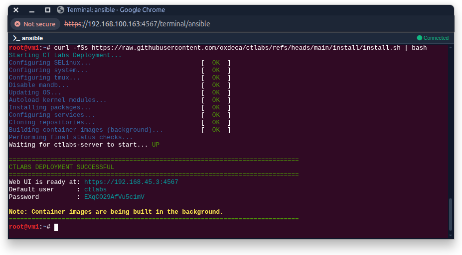
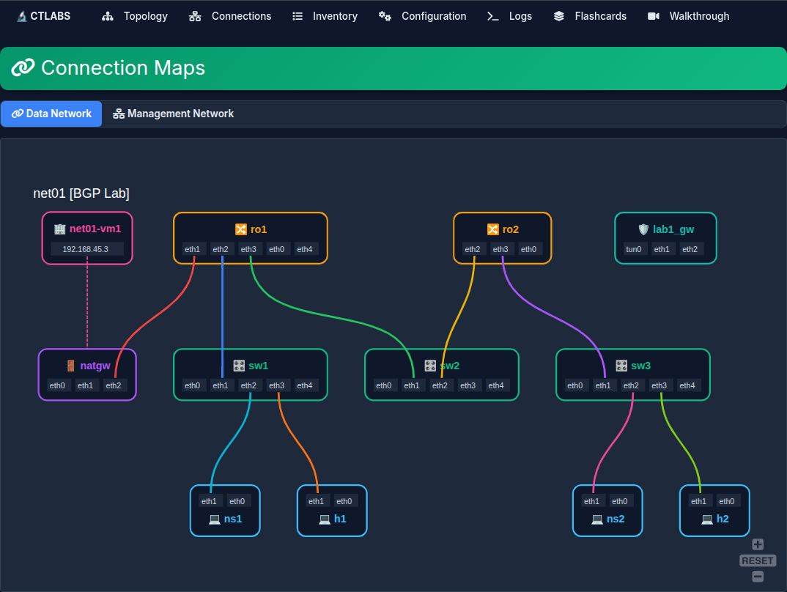
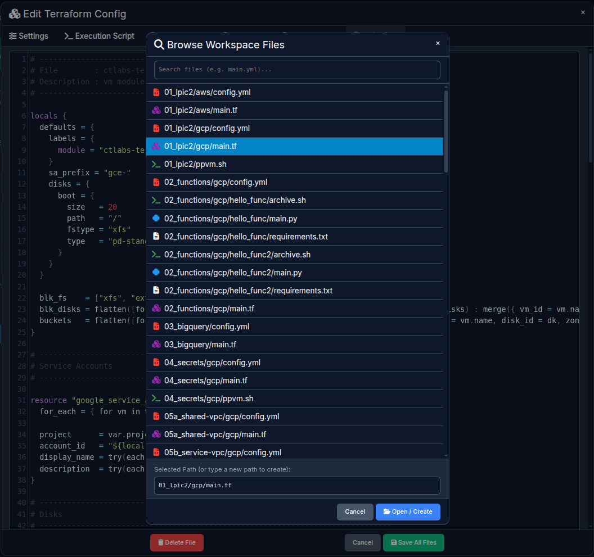
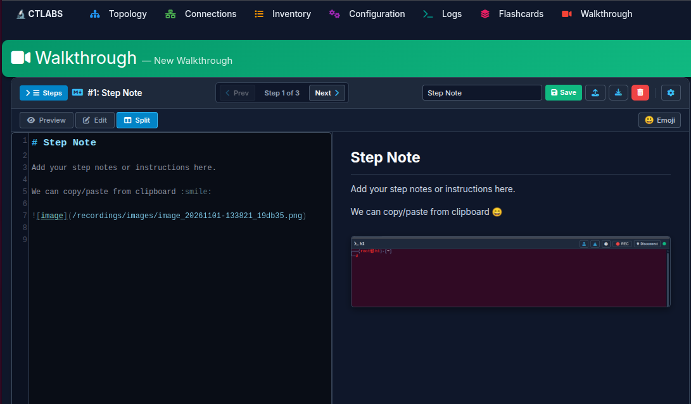
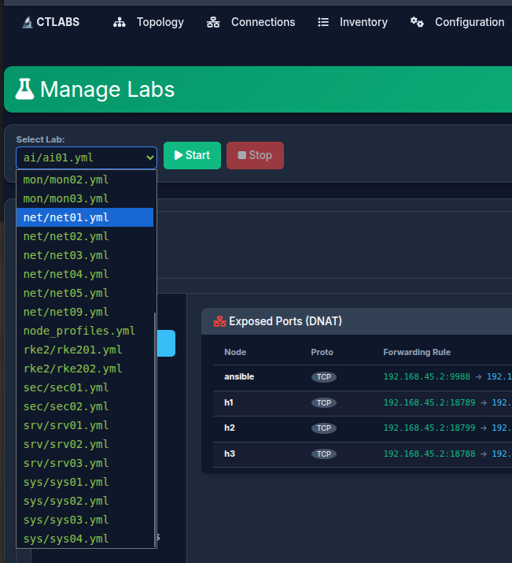

<div align="center">

# CTLABS 🧪

### The Hybrid Container & KVM Network Lab Workbench with Interactive Walkthroughs

[](LICENSE)
[](https://github.com/oxdeca/ctlabs)
[](https://podman.io)
[](https://www.qemu.org)
[](https://www.ansible.com)
[](https://asciinema.org)
[](https://github.com/oxdeca/ctlabs/pulls)

**CTLABS** is a lightweight, web-first laboratory workbench designed for platform engineers, network architects, and DevOps practitioners. It enables rapid provisioning of complex, isolated network topologies combining **Podman containers** and **QEMU/KVM virtual machines** on a single machine or cloud instance.

With integrated in-browser IDEs (Ansible, Terraform, Dockerfile), real-time SVG topology visualization, zero-latency web terminals, and an interactive multimedia Walkthrough & Documentation engine, CTLABS makes infrastructure experimentation and knowledge sharing completely reproducible.

---


</div>

## 📑 Table of Contents

- [Why CTLABS?](#-why-ctlabs)
- [Key Features](#-key-features)
- [Quick Start](#-quick-start)
- [Network Architecture](#-network-architecture)
- [Interactive Network Topology](#-interactive-network-topology)
- [Integrated Web Terminal](#-integrated-web-terminal)
- [In-Browser Automation (Ansible & Terraform)](#-in-browser-automation-ansible--terraform)
- [Interactive Walkthroughs & Documentation Engine](#-interactive-walkthroughs--documentation-engine)
- [Managing Labs](#-managing-labs)
- [Contributing](#-contributing)
- [License](#-license)

---

## 💡 Why CTLABS?

Most lab environments force you to choose between heavy, resource-intensive hypervisors (GNS3, Eve-NG, Proxmox) or lightweight tools that only do containers (Containerlab, Kind, Minikube). **CTLABS bridges the gap**:

| Feature | CTLABS | Eve-NG / GNS3 | Vagrant / VirtualBox | Containerlab |
| :--- | :---: | :---: | :---: | :---: |
| **Hybrid (Containers + QEMU VMs)** | ✅ **Native** | ⚠️ VM-heavy | ❌ VMs only | ⚠️ Mostly containers |
| **Footprint & Speed** | ⚡ **Ultra-lightweight** | 🐢 Heavy footprint | 🐢 Slow boot times | ⚡ Lightweight |
| **Web UI & Management Console** | ✅ **Built-in** | ⚠️ Clunky legacy UI | ❌ CLI only | ❌ CLI only |
| **Live SVG Topology Maps** | ✅ **Dynamic (Data & Mgmt)** | ⚠️ Manual layout | ❌ None | ⚠️ Graphviz / D3 |
| **Built-in Web Terminals** | ✅ **xterm.js + File Transfer** | ⚠️ Requires native telnet | ❌ SSH CLI only | ❌ SSH CLI only |
| **In-Browser Ansible / Terraform IDE** | ✅ **With live streaming** | ❌ None | ❌ None | ❌ None |
| **Interactive Walkthrough Player** | ✅ **Casts, Videos & Notes** | ❌ None | ❌ None | ❌ None |
| **1-Click DOCX & PDF Export** | ✅ **Built-in** | ❌ None | ❌ None | ❌ None |
| **Single-Command Setup** | ✅ `curl ... \| bash` | ❌ Multi-GB ISO install | ⚠️ Multi-tool setup | ⚠️ Package install |

---

## ✨ Key Features

* **Hybrid Virtualization:** Combine high-density Podman containers and full QEMU/KVM virtual machines inside the same isolated network fabric via TAP interfaces.
* **Declarative Lab-as-Code:** Define multi-node environments, NICs, and link interconnections with clean, readable YAML definitions.
* **Segregated Network Planes:** Automatic segregation of Management (`mgmt`), Data (`data`), Transit (`transit`), and Edge (`edge`) networks with Linux VRF isolation.
* **Interactive SVG Topology Visualizer:** Auto-generates real-time, interactive maps with pan/zoom, link inspections, and right-click terminal launching.
* **Low-Latency Web Terminals:** Full xterm.js terminals with direct container exec, QEMU serial console access, drag-and-drop file upload, directory downloads, and tmux persistence.
* **In-Browser Automation IDE:** Multi-file editors for Ansible, Terraform, and Dockerfiles with workspace profiles, ad-hoc execution runners, Vim mode, and live streaming output.
* **Ad-Hoc Runtime DNAT:** Expose lab ports to the host or public internet on the fly with a complete audit trail in operational logs.
* **Interactive Walkthroughs & Documentation:**
  * Record terminal sessions (`.cast` with native Asciicast v1/v2/v3 support).
  * Record browser screen videos (`.webm`/`.mp4`) with rectangular crop selection and mic mixing.
  * Rich Markdown notes with relative image links, interactive lightbox, emoji picker, and Vi mode.
  * One-click export to standalone Word (`.docx`) and styled, print-ready PDF reports with embedded diagrams.
  * Export/import complete lab sets as portable zip bundles.

---

## 🚀 Quick Start

### 1. Prerequisites

A clean Linux host or VM running **CentOS Stream 9 / RHEL 9** (or compatible enterprise Linux) with **nested virtualization enabled**:

```bash
# Verify nested virtualization is supported (result should be > 0)
grep -cw vmx /proc/cpuinfo || grep -cw svm /proc/cpuinfo
```

**Recommended Specifications:**
* **vCPUs:** 2 or more
* **Memory:** 4 GB RAM minimum (8 GB+ recommended for labs with multiple QEMU VMs)
* **Storage:** 20 GB+ free disk space

#### Example: Spinning up a Google Cloud (GCP) Spot VM

```bash
gcloud compute instances create ctlabs-vm \
    --zone=us-central1-a \
    --machine-type=n1-standard-2 \
    --image-family=centos-stream-9 \
    --image-project=centos-cloud \
    --boot-disk-size=30GB \
    --enable-nested-virtualization \
    --provisioning-model=SPOT \
    --instance-termination-action=STOP
```

---

### 2. Single-Line Installation

SSH into your VM and run the automated installer:

```bash
curl -fSs https://raw.githubusercontent.com/oxdeca/ctlabs/refs/heads/main/install/install.sh | bash
```

The installer configures dependencies (Podman, QEMU/KVM, Ruby, systemd services) and prints your access credentials upon completion:



---

### 3. Accessing the Web Console

Open your browser and navigate to:
```
https://<YOUR_VM_IP>:5678
```

> **Note:** If your VM is behind a cloud NAT/firewall, ensure TCP port `5678` is permitted in your cloud security group and access the URL using your public IP.


---

## 🌐 Network Architecture

CTLABS automatically segments network traffic into distinct planes to accurately simulate real-world data centers and enterprise topologies:

```yaml
topology:
  - hv: lab-vm1
    planes:
      mgmt:
        nodes:
          ansible:
            type: controller
          sw0:
            type: switch
          ro0:
            type: router
      edge:
        nodes:
          natgw:
            type: gateway
      transit:
        nodes:
          ro1:
            type: router
      data:
        nodes:
          sw1:
            type: switch
          sw2:
            type: switch
          h1:
            type: host
          h2:
            type: host

    links:
      - [ "ro0:eth1", "natgw:eth1" ]
      - [ "ro1:eth1", "natgw:eth2" ]
      - [ "ro1:eth2", "sw1:eth1"   ]
      - [ "ro1:eth3", "sw2:eth1"   ]
      - [ "sw1:eth2", "h1:eth1"    ]
      - [ "sw2:eth2", "h2:eth1"    ]
```

* **Management Plane (`mgmt`):** Isolated out-of-band management network connected via Linux VRF. Houses the Ansible controller and node management interfaces without polluting data routing tables.
* **Data Plane (`data`):** Simulates the primary application communication paths. Links, bridges, and IP schemes are completely user-defined.
* **Transit Plane (`transit`):** Dedicated segment for site-to-site VPNs, BGP peering, and overlay network tunnels (WireGuard, VXLAN, Cilium).
* **Edge Plane (`edge`):** Represents perimeter gateways, NAT boundaries, and external internet connectivity.



---

## 🗺️ Interactive Network Topology

CTLABS automatically renders real-time interactive SVG diagrams directly from your running environment:

* **Dual Plane Views:** Switch seamlessly between **Data Network Topology** and **Management Network Topology**.
* **Direct Node Interaction:** Right-click any node on the topology canvas to immediately open an interactive Web Terminal or inspect interfaces.
* **Exportable Diagrams:** Export live lab topologies directly into Graphviz `.dot` or `.svg` assets inside your documentation walkthroughs.


---

## 💻 Integrated Web Terminal

Every container and virtual machine in your lab is directly accessible right from your browser:

* **xterm.js Powered:** Full ANSI color support, customizable fonts, and native copy-paste shortcuts.
* **Instant Terminal Access:** Launch terminals from the Topology diagram, Connections table, or Nodes inventory:
  1. *Topology View:* Right-click any node and select **Open Web Terminal**.
  2. *Nodes List:* Click the `>_` terminal icon.
* **Integrated File Transfer:** Drag and drop files directly onto the terminal window to upload, or browse and download node directories on the fly.


---

## ⚙️ In-Browser Automation (Ansible & Terraform)

Configure and automate your lab nodes without leaving the browser:


### Ansible Editor & Execution Runner
* **Multi-File Workspace:** Edit playbooks, inventory files, roles, and group variables with tabbed navigation.
* **Vim Mode & Settings:** Built-in Vim keybindings (`:w`, `:wq`, visual block mode) and editor customization.
* **Workspace Profiles & Ad-Hoc Runner:** Execute full playbooks or trigger single-tag/single-host runs (`-l`, `-t`, extra args) with real-time log streaming.


### Terraform Editor
* Edit and plan Terraform infrastructure definitions side-by-side with your container topologies.



---

## 📚 Interactive Walkthroughs & Documentation Engine

Documenting lab experiments, tutorials, and post-mortems is built directly into CTLABS:


### Multimedia Step Sequence
Organize procedures into ordered steps combining three rich media types:
1. **Terminal Recordings (`.cast`):** Record terminal actions with one click (`REC` button). Supports Asciicast v1, v2, and modern macOS Asciicast v3 formats with scrubbing and text selection.
2. **Screen Video Recordings (`.webm` / `.mp4`):** Capture full screen or interactive rectangular crop areas with Web Audio mic mixing.
3. **Markdown Notes with Relative Images:** Full GitHub Flavored Markdown editor with live preview, Obsidian-style image sizing (`|300x200`), emoji picker, and modal image lightboxes.

### Picture Inspector
Manage all image assets in your walkthrough set with thumbnail previews, used vs. unused section grouping, and batch deletion.

### Export to Word (.docx) & Styled PDF
Export individual steps or entire walkthrough sets as unified, professionally formatted PDF documents (with cover page, table of contents, and syntax-highlighted code blocks) or Word `.docx` documents.




---

## 📦 Managing Labs

Starting, stopping, and inspecting labs is straightforward via the Web UI or CLI:

1. **Verify Images:** The `Nodes` table shows green indicators for available base images.
2. **Start Lab:** Click **Start** to spin up switches, bridges, containers, and QEMU virtual machines in seconds.
3. **Stop Lab:** Click **Stop** to cleanly tear down the network namespace and free resources.



---

## 🤝 Contributing

Contributions, feature ideas, and feedback are welcome!
Feel free to open an [Issue](https://github.com/oxdeca/ctlabs/issues) or submit a [Pull Request](https://github.com/oxdeca/ctlabs/pulls).

1. Fork the Project
2. Create your Feature Branch (`git checkout -b feature/AmazingFeature`)
3. Commit your Changes (`git commit -m 'Add some AmazingFeature'`)
4. Push to the Branch (`git push origin feature/AmazingFeature`)
5. Open a Pull Request

---

## 📄 License

Distributed under the MIT License. See [`LICENSE`](LICENSE) for more information.
