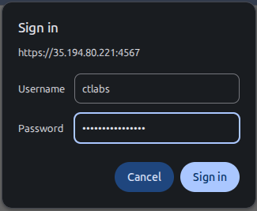
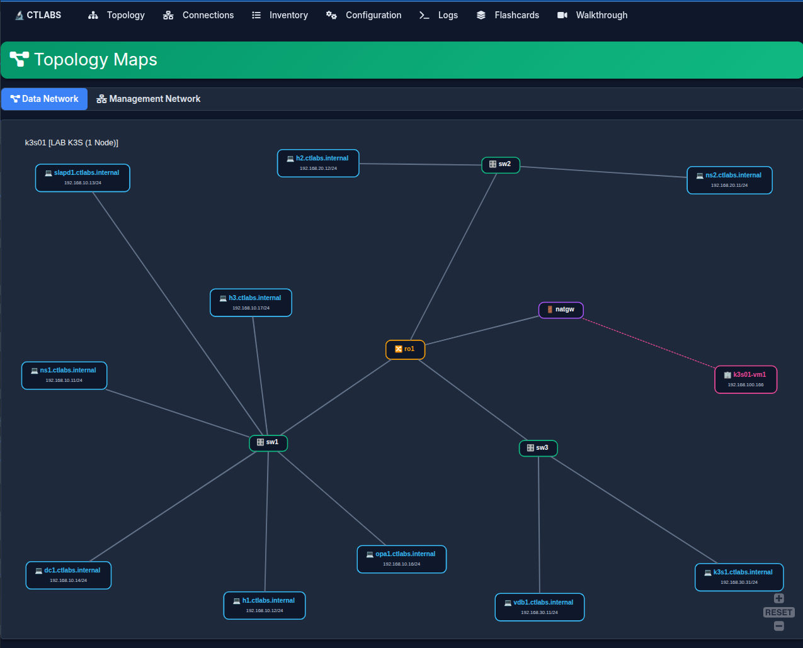
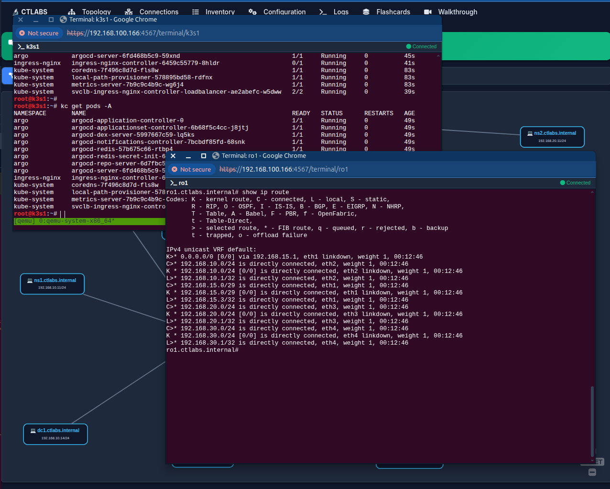
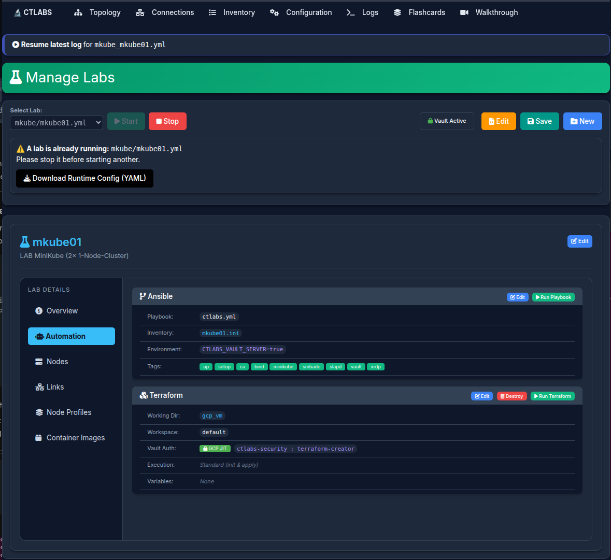
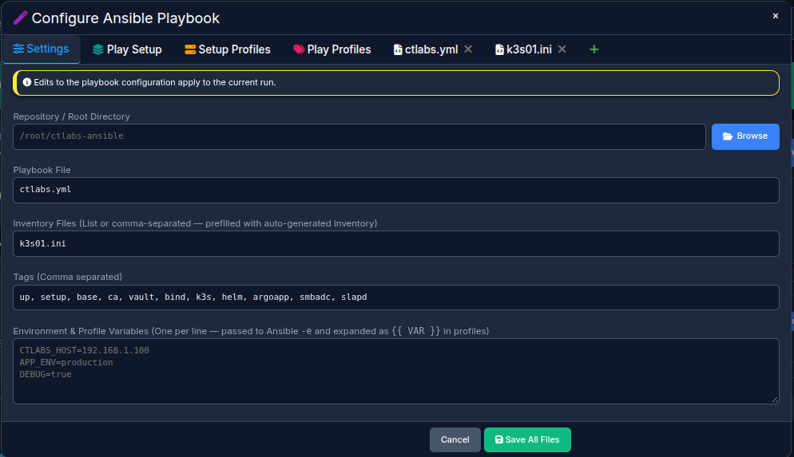
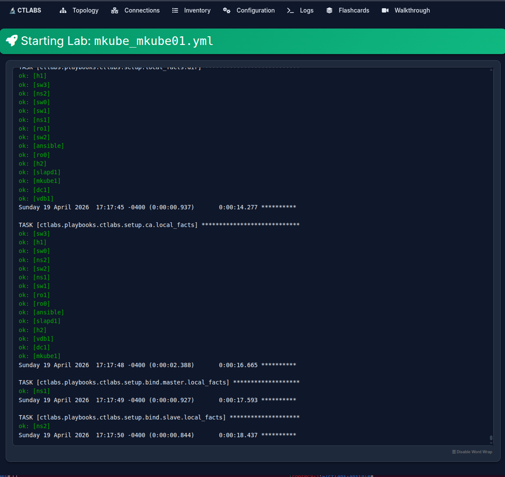
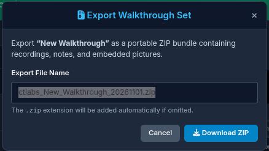
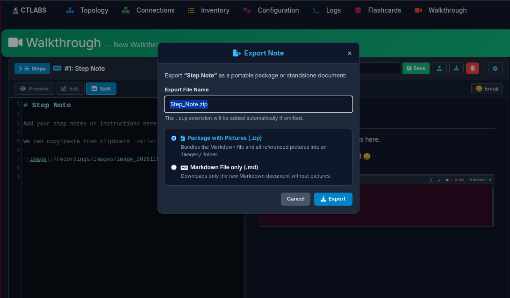

<div align="center">

# CTLABS 🧪

### The Hands-On Playground & Learning Workbench for Systems, Security & Infrastructure Research

[](LICENSE)
[](https://github.com/oxdeca/ctlabs)
[](https://podman.io)
[](https://www.qemu.org)
[](https://www.ansible.com)
[](https://asciinema.org)
[](https://github.com/oxdeca/ctlabs/pulls)

**CTLABS** is a flexible, web-first laboratory workbench designed for hands-on experimentation, technical training, interactive tutorials, security research, and operating systems study.

Whether you are studying operating systems kernel internals (like **xv6**), analyzing x86/ARM exploitation, orchestrating multi-node Kubernetes clusters, or practicing complex network routing—CTLABS provides a disposable, reproducible playground. **Break things, experiment freely, and restart from a clean slate in seconds.**

---


</div>

## 📑 Table of Contents

- [The CTLABS Philosophy](#-the-ctlabs-philosophy)
- [Key Capabilities](#-key-capabilities)
- [Quick Start](#-quick-start)
- [Network Architecture & Planes](#-network-architecture--planes)
- [Interactive Network Topology](#-interactive-network-topology)
- [Integrated Web Terminal](#-integrated-web-terminal)
- [In-Browser Automation (Ansible & Terraform)](#-in-browser-automation-ansible--terraform)
- [Interactive Walkthroughs & Documentation Engine](#-interactive-walkthroughs--documentation-engine)
- [Managing Labs](#-managing-labs)
- [Contributing](#-contributing)
- [License](#-license)

---

## 💡 The CTLABS Philosophy

### 1. Zero Fear of Messing Up
Real learning and security research happen when you push systems to their breaking point. In CTLABS, all infrastructure is defined as code. You can trigger kernel panics, break network routing, execute malicious payloads, or tear down services—and then spin the entire environment back up into a pristine state with one click.

### 2. Hybrid & Heterogeneous Environments
No single virtualization technology fits every experiment. CTLABS lets you combine:
* **High-density Podman containers** for lightweight services, switches, routers, and tools.
* **Full QEMU/KVM Virtual Machines** nested seamlessly inside containers and connected via TAP interfaces when you need real kernel access, custom storage drivers, or non-Linux OSes (Windows, BSD).
* **Multi-Architecture Support:** Leverage QEMU's emulation capabilities to run cross-architecture environments (e.g. x86_64, ARM, RISC-V).
* **Study & Research Labs:** Easily deploy specialized targets such as **xv6** teaching operating systems, exploit testing sandboxes, or multi-node Kubernetes clusters.

### 3. Integrated Learning & Walkthrough Companion
Never juggle between a terminal, a video recorder, and a separate documentation tool. CTLABS integrates an interactive **Walkthrough Engine** directly alongside your running machines: record terminal sessions (`.cast`), capture screen video with audio, write rich Markdown notes with diagrams and flashcards, and export your findings into standalone PDF and Word documents.

### 4. A Controlled Sandbox for Autonomous AI Agents & Systems Development
Autonomous AI coding, DevOps, and security agents need real environments with root privileges, actual network interfaces, and system services—without endangering host stability or sensitive networks. CTLABS is the ideal controlled execution sandbox:
* **True Isolation:** Isolated network namespaces, private Linux VRFs, and scoped cgroups confine agent activity safely.
* **Safe Autonomous Execution:** Agents can compile kernels, test server daemons, reconfigure firewalls, and run Ansible automation freely.
* **Instant Teardown & Reset:** If an agent hallucinates, breaks network routes, or panics a kernel, the entire environment resets to a clean baseline in seconds.
* **Self-Hosting & Dogfooding:** In fact, CTLABS develops, debugs, and runs its own server daemon (`ctlabs-server`) and companion AI agents inside this exact controlled sandbox!

> *"Really, there is no limit other than your imagination."*

---

## ✨ Key Capabilities

* **Heterogeneous Hybrid Labs:** Run containers and QEMU virtual machines on the same isolated virtual network fabric.
* **Controlled AI Agent Sandbox:** Safe, reproducible multi-node playground for autonomous AI agents, security tooling, and software development.
* **Declarative Lab-as-Code:** Define multi-node topologies, network links, and hardware profiles in simple, readable YAML.
* **Isolated Network Planes:** Automatic segregation of Management (`mgmt`), Data (`data`), Transit (`transit`), and Edge (`edge`) networks with Linux VRF isolation.
* **Interactive SVG Topology Maps:** Real-time visual network diagrams with pan/zoom, link inspection, and right-click terminal launching.
* **Zero-Latency Web Terminals:** Full xterm.js terminals with direct container exec, QEMU serial console access, drag-and-drop file upload, directory downloads, and tmux persistence.
* **In-Browser Automation IDE:** Tabbed editors for Ansible, Terraform, and Dockerfiles with workspace profiles, ad-hoc execution runners, Vim mode, and live unbuffered streaming logs.
* **Ad-Hoc Runtime DNAT:** Expose lab ports to the host or public internet on the fly with a complete audit trail in operational logs.
* **Interactive Walkthroughs & Documentation Engine:**
  * Record terminal sessions (`.cast` with native Asciicast v1, v2, and v3 support).
  * Record screen videos (`.webm` / `.mp4`) with rectangular crop selection and mic mixing.
  * Rich Markdown notes with relative image links, Obsidian-style resizing (`|300x200`), and modal lightboxes.
  * One-click export to standalone Word (`.docx`) and styled, print-ready PDF reports.
  * Export and import complete lab walkthrough sets as portable zip bundles.

---

## 🚀 Quick Start

### 1. Prerequisites

A clean Linux host or VM running **CentOS Stream 9 / RHEL 9** with **nested virtualization enabled**:

```bash
# Verify nested virtualization is supported (result should be > 0)
grep -cw vmx /proc/cpuinfo || grep -cw svm /proc/cpuinfo
```

**Recommended Specifications:**
* **vCPUs:** 2 or more
* **Memory:** 4 GB RAM minimum (8 GB+ recommended for labs with multiple QEMU VMs)
* **Storage:** 20 GB+ free disk space

#### Example: Spinning up a Google Cloud (GCP) Spot VM

```bash
gcloud compute instances create ctlabs-vm \
    --zone=us-central1-a \
    --machine-type=n1-standard-2 \
    --image-family=centos-stream-9 \
    --image-project=centos-cloud \
    --boot-disk-size=30GB \
    --enable-nested-virtualization \
    --provisioning-model=SPOT \
    --instance-termination-action=STOP
```

---

### 2. Single-Line Installation

SSH into your VM and run the automated installer:

```bash
curl -fSs https://raw.githubusercontent.com/oxdeca/ctlabs/refs/heads/main/install/install.sh | bash
```

The installer configures dependencies (Podman, QEMU/KVM, Ruby, systemd services) and prints your access credentials upon completion:


---

### 3. Accessing the Web Workbench

Open your browser and navigate to:
```
https://<YOUR_VM_IP>:5678
```

> **Note:** If your VM is behind a cloud NAT/firewall, ensure TCP port `5678` is permitted in your cloud security group and access the URL using your public IP.



---

## 🌐 Network Architecture & Planes

CTLABS automatically segments network traffic into distinct planes to accurately simulate real-world data centers, cloud boundaries, and enterprise topologies:

```yaml
topology:
  - hv: lab-vm1
    planes:
      mgmt:
        nodes:
          ansible:
            type: controller
          sw0:
            type: switch
          ro0:
            type: router
      edge:
        nodes:
          natgw:
            type: gateway
      transit:
        nodes:
          ro1:
            type: router
      data:
        nodes:
          sw1:
            type: switch
          sw2:
            type: switch
          h1:
            type: host
          h2:
            type: host

    links:
      - [ "ro0:eth1", "natgw:eth1" ]
      - [ "ro1:eth1", "natgw:eth2" ]
      - [ "ro1:eth2", "sw1:eth1"   ]
      - [ "ro1:eth3", "sw2:eth1"   ]
      - [ "sw1:eth2", "h1:eth1"    ]
      - [ "sw2:eth2", "h2:eth1"    ]
```

* **Management Plane (`mgmt`):** Isolated out-of-band management network connected via Linux VRF. Houses the Ansible controller and node management interfaces without polluting data routing tables.
* **Data Plane (`data`):** Simulates the primary application communication paths. Links, bridges, and IP schemes are completely user-defined.
* **Transit Plane (`transit`):** Dedicated segment for site-to-site VPNs, BGP peering, and overlay network tunnels (WireGuard, VXLAN, Cilium).
* **Edge Plane (`edge`):** Represents perimeter gateways, NAT boundaries, and external internet connectivity.


---

## 🗺️ Interactive Network Topology

CTLABS automatically renders real-time interactive SVG diagrams directly from your running environment:

* **Dual Plane Views:** Switch seamlessly between **Data Network Topology** and **Management Network Topology**.
* **Direct Node Interaction:** Right-click any node on the topology canvas to immediately open an interactive Web Terminal or inspect interfaces.
* **Exportable Diagrams:** Export live lab topologies directly into Graphviz `.dot` or `.svg` assets inside your documentation walkthroughs.



---

## 💻 Integrated Web Terminal

Every container and virtual machine in your lab is directly accessible right from your browser:

* **xterm.js Powered:** Full ANSI color support, customizable fonts, and native copy-paste shortcuts.
* **Instant Terminal Access:** Launch terminals from the Topology diagram, Connections table, or Nodes inventory:
  1. *Topology View:* Right-click any node and select **Open Web Terminal**.
  2. *Nodes List:* Click the `>_` terminal icon.
* **Integrated File Transfer:** Drag and drop files directly onto the terminal window to upload, or browse and download node directories on the fly.



---

## ⚙️ In-Browser Automation (Ansible & Terraform)

Configure and automate your lab nodes without leaving the browser:



### Ansible Editor & Execution Runner
* **Multi-File Workspace:** Edit playbooks, inventory files, roles, and group variables with tabbed navigation.
* **Vim Mode & Settings:** Built-in Vim keybindings (`:w`, `:wq`, visual block mode) and editor customization.
* **Workspace Profiles & Ad-Hoc Runner:** Execute full playbooks or trigger single-tag/single-host runs (`-l`, `-t`, extra args) with real-time log streaming.




### Terraform Editor
* Edit and plan Terraform infrastructure definitions side-by-side with your container topologies.


---

## 📚 Interactive Walkthroughs & Documentation Engine

Documenting lab experiments, security investigations, tutorials, and post-mortems is built directly into CTLABS:



### Multimedia Step Sequence
Organize procedures into ordered steps combining three rich media types:
1. **Terminal Recordings (`.cast`):** Record terminal actions with one click (`REC` button). Supports Asciicast v1, v2, and modern macOS Asciicast v3 formats with scrubbing and text selection.
2. **Screen Video Recordings (`.webm` / `.mp4`):** Capture full screen or interactive rectangular crop areas with Web Audio mic mixing.
3. **Markdown Notes with Relative Images:** Full GitHub Flavored Markdown editor with live preview, Obsidian-style image sizing (`|300x200`), emoji picker, and modal image lightboxes.

### Picture Inspector
Manage all image assets in your walkthrough set with thumbnail previews, used vs. unused section grouping, and batch deletion.

### Export to Word (.docx) & Styled PDF
Export individual steps or entire walkthrough sets as unified, professionally formatted PDF documents (with cover page, table of contents, and syntax-highlighted code blocks) or Word `.docx` documents.




---

## 📦 Managing Labs

Starting, stopping, and inspecting labs is straightforward via the Web UI or CLI:

1. **Verify Images:** The `Nodes` table shows green indicators for available base images.
2. **Start Lab:** Click **Start** to spin up switches, bridges, containers, and QEMU virtual machines in seconds.
3. **Stop Lab:** Click **Stop** to cleanly tear down the network namespace and free resources.


---

## 🤝 Contributing

Contributions, lab ideas, and feedback are welcome!
Feel free to open an [Issue](https://github.com/oxdeca/ctlabs/issues) or submit a [Pull Request](https://github.com/oxdeca/ctlabs/pulls).

1. Fork the Project
2. Create your Feature Branch (`git checkout -b feature/AmazingFeature`)
3. Commit your Changes (`git commit -m 'Add some AmazingFeature'`)
4. Push to the Branch (`git push origin feature/AmazingFeature`)
5. Open a Pull Request

---

## 📄 License

Distributed under the MIT License. See [`LICENSE`](LICENSE) for more information.
